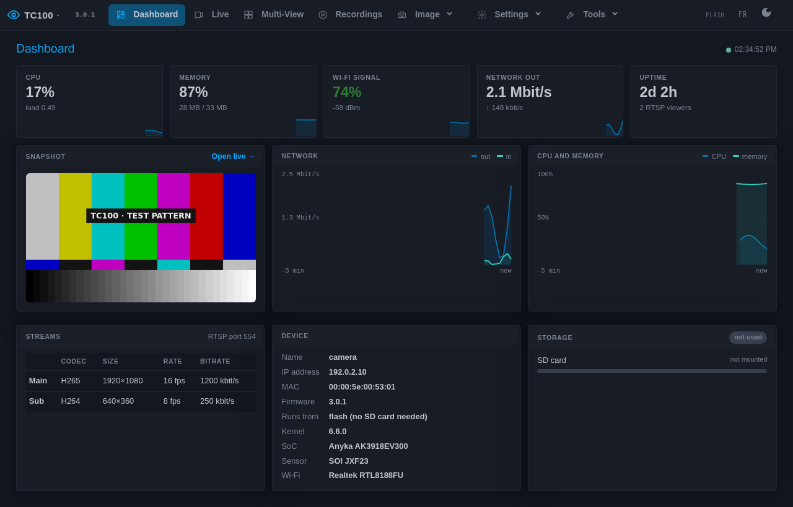
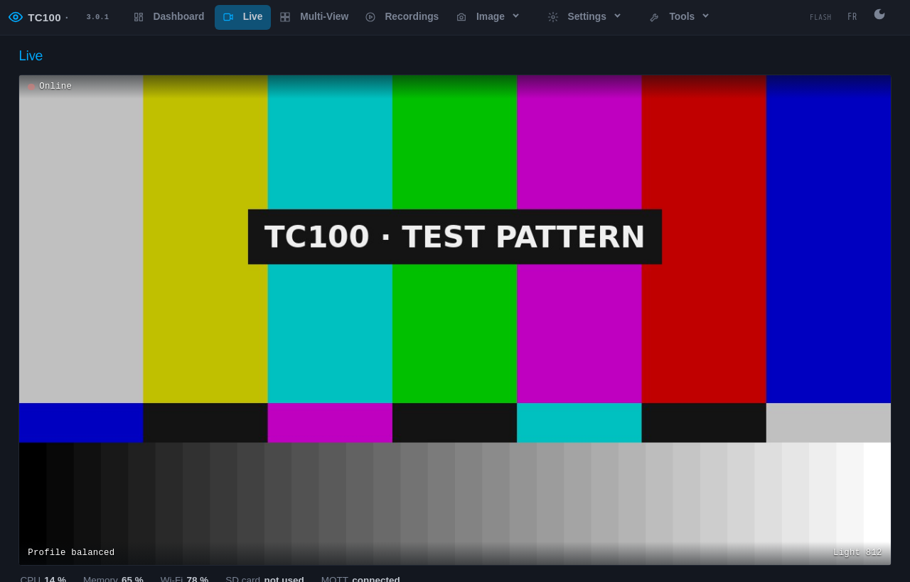
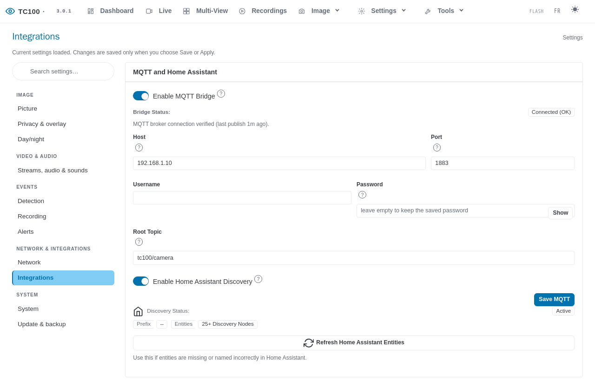
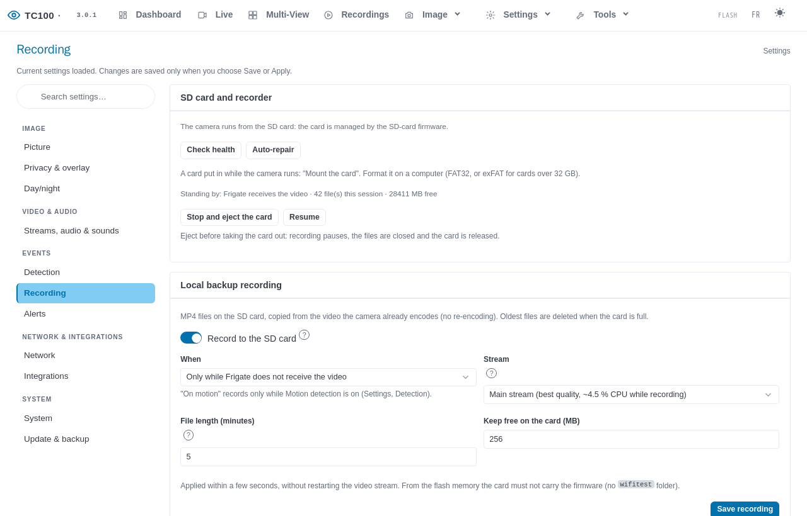
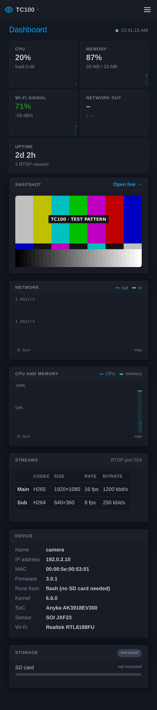

# TECKIN TC100 — free firmware

Free, local-only firmware (Linux 6.6 LTS) for the **TECKIN TC100 / TECKIN Click** indoor camera. It replaces the cloud
app with a camera that lives on your own network: a video stream for Frigate or any recorder, a live view in the browser,
Home Assistant, ONVIF and recording to a microSD card. No cloud, no account, no outgoing connection by default.

You install it by **copying files to a microSD card and powering the camera on**. No cable, no soldering, no need to open
the camera.

Every screenshot shows a test pattern instead of the camera image, and example addresses.

**Guides:** [Installation guide](docs/install.md) · [Guide d'installation (français)](docs/install.fr.md) ·
[Known issues](docs/known-issues.md) · [Changelog](CHANGELOG.md)

---

## What you get

- **Video over RTSP**: a 1080p main stream (H.265 or H.264) and a 640x360 sub-stream for detection, over TCP or UDP, with
  the microphone as an audio track.
  `rtsp://CAMERA-IP:554/video0_unicast` (main) and `rtsp://CAMERA-IP:554/video1_unicast` (sub).
- **Live view in the browser**: low-latency WebRTC (WHEP) when the browser supports it, otherwise smooth HTML5 video;
  a 2x2 multi-view page for up to 4 cameras; still pictures for Home Assistant.
- **ONVIF** (Profile T: discovery, events, two-way audio). Off by default: switch it on in Services.
- **MQTT and Home Assistant**: automatic discovery of about 50 entities (Wi-Fi signal, light, sound, night mode, SD
  card, LEDs...), commands from Home Assistant, chime and siren.
- **Frigate**: a configuration ready to paste, generated by the camera itself.
- **Recording on the microSD card**: MP4 files with sound, by default only while Frigate is not receiving the video.
- **Day and night** with IR LEDs, privacy masks, motion zones, live image tuning.
- **Easy to run**: setup wizard, English and French, light and dark theme, phone layout, **updates from the web page**
  (no SD card needed), backups, diagnostics, Wi-Fi rescue access point, safe mode after repeated crashes.

The full list is in [docs/linux-port/internals.md](docs/linux-port/internals.md#full-feature-list).

| | |
|---|---|
|  Live view |  Settings → Integrations |
|  Settings → Recording |  On a phone |

More screenshots: [gallery](docs/linux-port/internals.md#screenshots).

---

## Quick start

You need a TECKIN TC100, a **microSD card of 32 GB or less**, and a computer. Full details, with what you should see at
each step, in the **[installation guide](docs/install.md)** ([en français](docs/install.fr.md)).

1. **Download** `tc100-<version>-sd.zip` from the
   [releases](https://github.com/morgeek/TECKIN-TC100-Anyka-AK3918/releases).
2. **Format the card FAT32** and **unzip the package to the root of the card** (the folders `wifitest`, `tc100test`,
   `tc100-3`... must be visible directly on the card). A camera never set up on Wi-Fi also needs a `wifi.txt` file.
3. **Try it first (recommended):** add an empty file `ESSAI.txt` (or `TRIAL.txt`) at the root of the card. The firmware
   then runs from the card only; take the card out and the camera is as before.
4. **Card in the switched-off camera, power on, wait.** Blue LED blinking = working; red LED on = stopped, the reason is
   in `tc100-3/STATUS.txt` on the card.
5. **Open http://tc100/** (or the address your router shows) and follow the **setup wizard**. It asks you to choose a new
   password: the default one is public.
6. **Install into the camera** (without `ESSAI.txt` the card does it by itself; in trial mode use Settings → Update &
   backup → *Install to flash*). From then on the camera runs without the card and updates from the web page.

---

## Is it safe? The way back

- The camera is identified before anything is written; a camera the firmware does not recognise is **left untouched**
  (red LED, reason on the card).
- The bootloader (U-Boot), the radio data (`mac`) and the camera's identity are **never written**. Before anything is
  written, the whole original flash is saved to the card and checked; every partition written is read back.
- **The way back:** keep the card. Rename `tc100test/c66.img.installed` to `c66.img`, add an empty `RESTAURER.txt` at
  the root, power on: the camera writes its original firmware back (about 10 minutes). See the
  [installation guide](docs/install.md#7-the-way-back-to-the-original-firmware).
- **Safe mode:** after 3 short runs in a row (crash, watchdog), the camera starts only the Wi-Fi, the web page, ssh and
  the reset button so you can update or fix it without a serial console.
- Tested on **two cameras of the same hardware variant**. Not covered yet: other hardware variants, and a power cut
  during the one small write to the boot settings at the very start (do not unplug the camera during the first two
  minutes). Details and limits: [full text](docs/linux-port/internals.md#is-it-safe-full-text).

Use it only if you accept these limits. It is a hobby project, provided as is.

---

## Home Assistant and Frigate

1. In the wizard (or Settings → Integrations) pick the profile **Frigate + Home Assistant** and enter your MQTT broker.
2. **Give each camera its own name** (Settings → Network → Hostname), or two cameras merge into one Home Assistant
   device.
3. Home Assistant finds the camera by itself (MQTT discovery).
4. Frigate: Live view → More tools → Diagnostics gives a configuration to paste. It never contains the camera password:
   set the variable `FRIGATE_RTSP_PASSWORD` in Frigate's environment.

Details, still image setup and commands: [docs/linux-port/internals.md](docs/linux-port/internals.md#home-assistant-and-frigate-details)
and [docs/api.md](docs/api.md). Two-way audio: [docs/two-way-audio.md](docs/two-way-audio.md).

---

## Limits, and what is not included

- Plain **HTTP only** on the camera (a login, but no HTTPS): use it on your own network, never forward its ports from
  the internet. For HTTPS put a [reverse proxy](docs/linux-port/internals.md#https-with-a-reverse-proxy) in front.
- No VPN, no resolution change (1080p and 640x360), no card formatting from the web page, no encoder smart mode.
- Only one hardware variant is known so far (JX-F23 sensor, RTL8188FU Wi-Fi, 8 MiB flash):
  [hardware variants](docs/hardware-variants.md).
- Push-to-talk and two-way audio through the speaker are not yet checked on a camera.
- Colours are slightly warm, and by day in low light the camera drops to 10 fps on purpose.
- The default web password is public until you change it; a banner reminds you.

The up-to-date list is [docs/known-issues.md](docs/known-issues.md).

---

## Getting help

- Read the [troubleshooting section](docs/install.md#8-troubleshooting) of the installation guide.
- Open an [issue on GitHub](https://github.com/morgeek/TECKIN-TC100-Anyka-AK3918/issues/new/choose); for an unknown
  camera variant use the *Hardware inventory* form and attach `tc100-inventory.txt` (see the guide).
- Never post your password, your Wi-Fi password or `tc100-3/backup/flash-stock.bin` (the copy of your camera's memory).

---

## For developers

Kernel patch series, build and CI, test loop, status and open items: **[docs/linux-port/README.md](docs/linux-port/README.md)**.

Technical material that used to be in this README (flash layout, how it works, the hardware and OpenIPC, where the
project comes from, repository structure, HTTPS reverse proxy, the full feature list) is in
**[docs/linux-port/internals.md](docs/linux-port/internals.md)**. HTTP API: [docs/api.md](docs/api.md).

Licence: GNU General Public License version 2 ([LICENSE](LICENSE)); third-party code keeps its own licence
([CREDITS.md](CREDITS.md)). The project began as a fork of
[TECKIN-TC100-Anyka-AK3918-camera-hacks](https://github.com/ThatUsernameAlreadyExist/TECKIN-TC100-Anyka-AK3918-camera-hacks)
and follows [OpenIPC](https://openipc.org)'s approach to the flash design.

---

*Local only. No cloud. Your camera, your network.*
